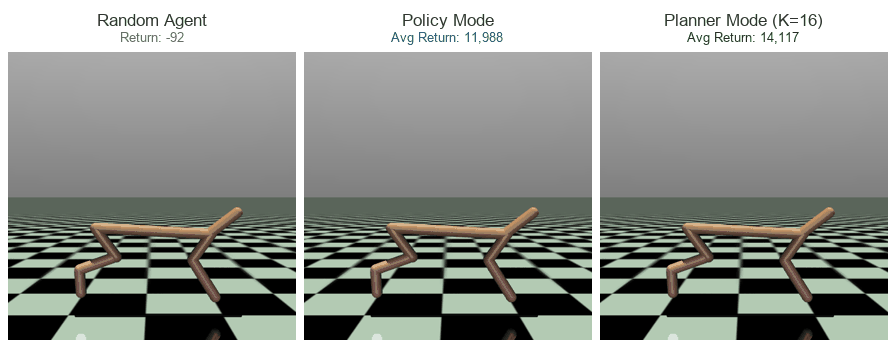

# Diffusion Planning vs. Diffusion Policy



Offline reinforcement learning with diffusion models on MuJoCo HalfCheetah.
One trained diffusion model runs two ways at test time: as a policy that samples a single action sequence, or as a planner that samples K sequences, scores each one in the simulator and acts on the best.

## What I built

- The framework: the Minari data pipeline and normalizer, MuJoCo state save and restore, the CNN U-Net with FiLM conditioning, the DDPM/DDIM sampler, policy mode, planner mode, the training loop and rollout evaluation.
- Three more model types on top of it, a diffusion Transformer, Diffuser and Decision Diffuser, together with the value function, the inverse dynamics model and the guided and classifier-free guidance samplers.

Team: Hun Tae Kim, Shane Dirksen, Towhidul Islam, Zeiler Randall-Reed. Course project for CMPSC 291K Robot Learning, UC Santa Barbara, Winter 2026.

## Setup

Python 3.10 or newer (tested on 3.12). A CUDA GPU is recommended.

```bash
python -m venv .venv
source .venv/bin/activate            # Windows PowerShell: .\.venv\Scripts\Activate.ps1

pip install -U pip
# PyTorch for your CUDA version (cu128 shown; cu121 and cpu wheels also work)
pip install torch torchvision --index-url https://download.pytorch.org/whl/cu128
pip install -r requirements.txt
pip install -e .

# Download the Minari dataset
python scripts/download_datasets.py
```

On Linux or macOS, `bash scripts/setup_env.sh` runs the same steps.

The environment name `halfcheetah-medium-v2` used below maps to Gymnasium `HalfCheetah-v4` and the Minari dataset `mujoco/halfcheetah/medium-v0` (`src/diffplan/envs/make_env.py`).

## Train

```bash
python -m diffplan.train --config configs/train.yaml --env halfcheetah-medium-v2 --H 32
```

This trains the default model (Action CNN, a 1D U-Net over action sequences) for 200k steps and writes `runs/checkpoints/halfcheetah_medium_v2_H32.pt`. The other model types are selected with a config override:

```bash
python -m diffplan.train --config configs/train.yaml --env halfcheetah-medium-v2 --H 32 model.type=transformer
python -m diffplan.train --config configs/train.yaml --env halfcheetah-medium-v2 --H 32 model.type=trajectory
python -m diffplan.train --config configs/train.yaml --env halfcheetah-medium-v2 --H 32 model.type=decision
```

## Evaluate

```bash
# Policy mode: sample one action sequence per decision
python -m diffplan.eval --config configs/eval_policy.yaml \
    --ckpt runs/checkpoints/halfcheetah_medium_v2_H32.pt --H 32

# Planner mode: sample K=16 sequences, score each in the simulator, act on the best
python -m diffplan.eval --config configs/eval_planner.yaml \
    --ckpt runs/checkpoints/halfcheetah_medium_v2_H32.pt --K 16 --H 32
```

`python render_episodes.py` writes GIFs of the cheetah under random, policy and planner control to `runs/renders/`.

## Results

Action CNN on HalfCheetah-v4, trained for 200k steps on Minari `mujoco/halfcheetah/medium-v0`, horizon H=32, 20 DDIM sampling steps. Planner mode scores each candidate by its discounted return (discount 0.99) over the horizon.

| Mode | Candidates | Episodes | Mean return | Std |
|------|-----------|----------|-------------|-----|
| Policy | 1 | 20 | 11,988 | 2,409 |
| Planner | K=16 | 10 | 14,117 | 2,747 |

The Transformer, Diffuser and Decision Diffuser models are in the code; their results are not reported here.

Known limits: the planner scores candidates with the true simulator (MuJoCo state save and restore), an advantage policy mode does not have. The numbers come from 10 to 20 evaluation episodes, with no multi-seed or sweep results.

## Layout

```
configs/               YAML configs (base, train, eval, environments, sweeps)
src/diffplan/models/   U-Net, Transformer, Diffuser, Decision Diffuser, samplers, value function, inverse dynamics
src/diffplan/algorithms/  training loop, policy mode, planner mode
src/diffplan/data/     Minari loading, trajectory windows, normalizer
src/diffplan/envs/     environment mapping, MuJoCo state save and restore
src/diffplan/eval/     evaluation CLI, rollouts, metrics, timing
scripts/               dataset download, setup, batch train, eval and plot scripts
```

Architecture notes for the four models: [docs/model_comparison.md](docs/model_comparison.md).
